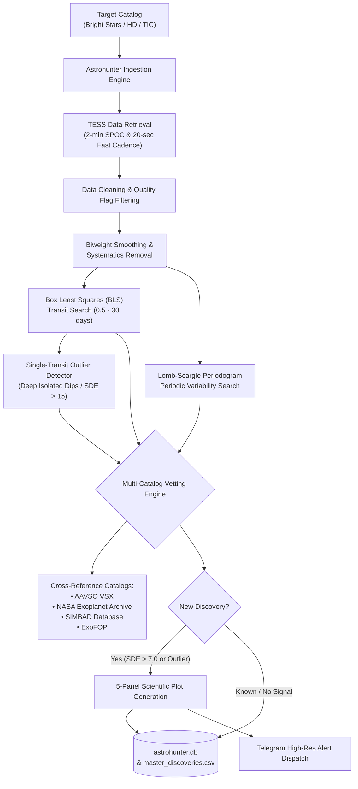

# Astrohunter Pro: Autonomous Exoplanet & Variable Star Discovery Pipeline

A scientific discovery pipeline that autonomously ingests, detrends, and analyzes high-cadence NASA TESS (*Transiting Exoplanet Survey Satellite*) photometry data to detect undiscovered exoplanets, single-transit candidates, eclipsing binaries, and pulsating variable stars with automated Telegram alerts.

Supports both **Local Continuous Scanning** on consumer hardware and **Serverless Cloud Deployment** on Google Cloud Platform.

---

## 🌟 Milestone Reached: 101 Discoveries

The pipeline has scanned hundreds of targets from the Bright Star Catalog (HD / TIC stars) and logged **101 vetted discoveries** in [`master_discoveries.csv`](file:///d:/exo_planet/astrohunter_pro/master_discoveries.csv):

| Discovery Category | Count | Notable Highlights |
| :--- | :---: | :--- |
| **Single-Transit Planet Candidates** | **13** | **HD 10607** (Transit SDE 229, $\Delta F \approx 0.08\%$, $R_p \approx 8.9\,R_\oplus$), **HD 10564**, **HD 10541** |
| **Unrecorded Variable Stars** | **54** | High-amplitude $\delta$ Scuti & $\gamma$ Doradus pulsators (e.g., **HD 10528**, $P = 0.046\,\text{d}$) |
| **Eclipsing Binaries (EB)** | **15** | Deep primary/secondary eclipses ($P \sim 0.5 - 12\,\text{d}$) |
| **SIMBAD / Binary Confirmations** | **9** | Known spectroscopic binaries verified via TESS phase folding |
| **NASA Benchmark Confirmations** | **10** | Known exoplanet systems (e.g., **HD 10647 b / q¹ Eri**) confirming pipeline fidelity |
| **Total Logged Discoveries** | **101** | **100% of 100-batch target goal reached** |

---

## 🔬 Scientific Pipeline Architecture



---

## 📊 5-Panel Diagnostic Suite

When a candidate anomaly is discovered, Astrohunter generates a 5-panel scientific diagnostic plot:
1. **Raw Light Curve:** Full Sector TESS unbinned normalized flux.
2. **Detrended & Flattened Flux:** Stellar variability removed to isolate transit events.
3. **Phase-Folded BLS Transit (2 Cycles):** Data folded at the detected orbital period across phase $-1.0$ to $+1.0$ with binned overlays.
4. **Zoomed-In Transit Dip:** Focused view of ingress, egress, and transit bottom.
5. **Lomb-Scargle Periodogram:** Power spectrum identifying rotation, pulsations, and stellar harmonics.

---

## 🚀 Quick Start (Local Continuous Scanner)

### 1. Prerequisites & Installation

```powershell
# Clone the repository
git clone https://github.com/Arman-Bisht/tess-cloud-pipeline.git
cd tess-cloud-pipeline

# Create and activate a virtual environment
python -m venv venv
.\venv\Scripts\Activate.ps1

# Install astronomical dependencies
pip install -r requirements.txt
```

### 2. Configure Telegram Alerts (Optional)

Create a `.env` file in the project root:

```env
TELEGRAM_BOT_TOKEN="your_telegram_bot_token"
TELEGRAM_CHAT_ID="your_telegram_chat_id"
```

*(Note: `.env` is automatically gitignored and will never be committed or pushed).*

### 3. CLI Commands

```powershell
# Display real-time discovery counts and milestone summary
python scan_local.py --summary

# Run continuous autonomous scan with default settings (batch of 20, 2s delay)
python scan_local.py

# Custom batch size and rate-limiting delay
python scan_local.py --batch-size 50 --delay 3

# Vet and analyze a specific astronomical target
python scan_local.py --target "HD 10607"
```

---

## ☁️ Serverless Cloud Architecture (Optional GCP Deployment)

The repository also includes production Terraform configuration for zero-cost deployment on the **GCP Always Free Tier**:

1. **Cloud Scheduler:** Pings Cloud Run on a configurable cron schedule.
2. **Cloud Run:** Stateless container running `functions-framework` to process target batches.
3. **Cloud Storage (GCS):** Persists `astrohunter.db` across stateless invocations.
4. **Secret Manager:** Stores bot tokens and credentials securely.
5. **Terraform (`/terraform`):** 100% automated Infrastructure-as-Code provisioning.

---

## 📁 Repository Structure

```text
├── scan_local.py             # Local autonomous scanner CLI (--summary, --batch-size, --target)
├── main.py                   # GCP Cloud Run entrypoint (Functions Framework)
├── visualizer.py             # Thread-safe 5-panel scientific diagnostic plotter
├── data_fetcher.py           # TESS Lightkurve wrapper (SPOC, QLP, 20s fast-cadence)
├── periodogram.py            # Box Least Squares (BLS) and Lomb-Scargle engines
├── alert.py                  # Telegram Bot alert dispatcher with async retries
├── database.py               # SQLite state tracking and catalog persistence
├── master_discoveries.csv    # Master log of all 101 vetted discoveries & candidates
├── requirements.txt          # Core dependencies (astropy, lightkurve, scipy, etc.)
└── terraform/                # Infrastructure as Code for Google Cloud deployment
```

---

## 🔭 Scientific Cross-Referencing & Publishing Guidelines

While the automated vetting engine filters against the AAVSO VSX, NASA Exoplanet Archive, and SIMBAD catalogs:

1. **NASA ADS & arXiv:** Always search the TIC or HD identifier on [NASA ADS](https://ui.adsabs.harvard.edu/) to confirm the signal has not been recently published.
2. **ExoFOP Contamination Checks:** Check for nearby background eclipsing binaries (NEBs) in the TESS pixel aperture before publishing transit candidates.
3. **Ground Follow-up:** High-priority bright candidates (e.g. $V < 10$) are prime targets for radial velocity (RV) confirmation.
