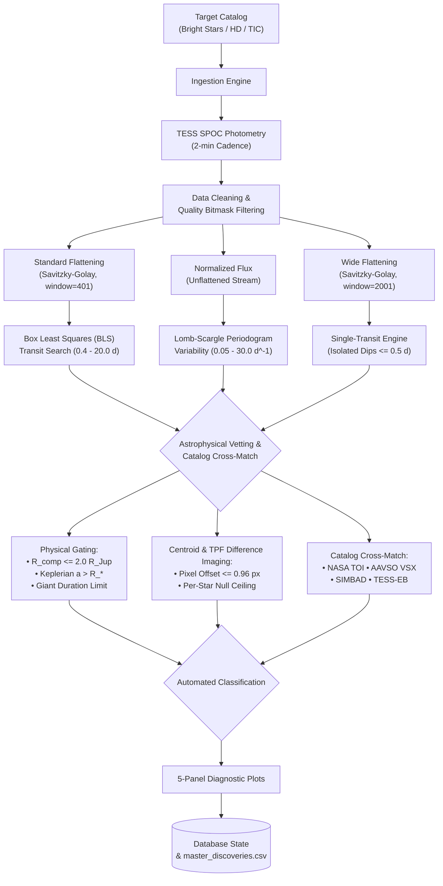

# Astrohunter Pro: Automated Photometry Mining Pipeline

[](https://github.com/astronomy/astrohunter-pro/actions/workflows/ci.yml)
[](LICENSE)
[](https://www.python.org/downloads/)

Astrohunter Pro is an automated Python pipeline for ingesting, detrending, searching, and vetting NASA Transiting Exoplanet Survey Satellite (TESS) light curves. It integrates multi-engine signal detection (Box Least Squares, Lomb-Scargle, and single-transit search) with automated physical gating, catalog cross-matching, and pixel-level Target Pixel File (TPF) difference imaging.

> **Scientific Classification Notice:** Passing automated pipeline tests does **not** constitute astrophysical validation.
> * **Tier A Definition:** *"Passes automated pipeline checks; not astrophysical validation."*
> * In the 50-target development benchmark, **9 of 32** Tier A candidates were confirmed non-planets (eclipsing binaries, blends, or variable stars).
> * Single-pixel difference-image centroid vetting excludes background blends only beyond approximately **1.0 pixel** ($21''$). Blends within $\approx 1\,\text{px}$ cannot be resolved by single-pixel difference imaging.

---

## Development Benchmark Performance

The pipeline's baseline performance was evaluated across **50 real TESS targets** with published ground-truth dispositions (28 confirmed transiting exoplanets, 22 non-planets comprising eclipsing binaries from Prša et al. 2022, false-positive TOIs, and variables). Full details are cataloged in [`docs/benchmark.md`](docs/benchmark.md).

| Metric | Value | 95% Wilson CI | Benchmark Basis |
| :--- | :---: | :---: | :--- |
| **Planet Recall (Sensitivity)** | **85.7%** (24/28) | [68.5%, 94.3%] | 28 confirmed transiting exoplanets ($P \le 20\,\text{d}$) |
| **Non-Planet Specificity** | **77.3%** (17/22) | [56.6%, 89.9%] | 22 eclipsing binaries, TOI false positives, & variables |
| **Sample Precision (PPV)** | **82.8%** (24/29) | [65.5%, 92.4%] | Balanced sample prevalence (56% planets) |
| **Overall Classification Accuracy** | **82.0%** (41/50) | [69.2%, 90.2%] | Majority baseline = 56.0% |
| **Positive Likelihood Ratio ($LR+$)** | **3.77** | N/A | $\text{Sensitivity} / (1 - \text{Specificity})$ |
| **Precision at $\pi = 50\%$ Prevalence** | **79.0%** | N/A | Synthetic balanced benchmark regime |
| **Precision at $\pi = 10\%$ Prevalence** | **29.5%** | N/A | Enriched candidate follow-up regime |
| **Precision at $\pi = 2\%$ Prevalence** | **7.1%** | N/A | Realistic blind field-star survey regime |

> **The Survey Regime Statement:** In an untargeted blind survey where the true prevalence of transiting planets among field stars is $\sim 1 - 2\%$, an automated positive trigger yields an expected precision of only **7.1%**. Automated candidate lists represent prioritized targets for follow-up, never validated planetary discoveries.

---

## Known Ground-Truth Recovery (AAVSO VSX)

In the HD 10000–10729 bright-star survey footprint (732 stars scanned, 497 observed by TESS), 34 stars cross-match with the AAVSO International Variable Star Index (VSX), of which 15 have published catalog periods. Full forensics are in [`docs/vsx_recovery.md`](docs/vsx_recovery.md).

| Regime | Catalog Filter | Recovered | Rate | 95% Wilson CI |
| :--- | :--- | :---: | :---: | :---: |
| **Unrestricted Published Periods** | All published-period HD stars in survey | 4/15 | **26.7%** | [10.9%, 52.0%] |
| **Search Grid Range** | $P \in [0.0333, 20.0]\,\text{d}$ ($f \le 30\,\text{d}^{-1}$) | 4/13 | **30.8%** | [12.7%, 57.6%] |
| **Single-Sector 3-Cycle Range** | $P \in [0.0333, 8.7]\,\text{d}$ ($N_{\text{cycles}} \ge 3.0$) | 4/12 | **33.3%** | [13.8%, 60.9%] |

*Recovered Targets:* HD 10720 ($P = 3.78442\,\text{d}$ vs $3.7845\,\text{d}$, $0.99998\times$, EA), HD 10502 ($P = 0.0436\,\text{d}$, $1.0000\times$, DSCTC), HD 10081 ($P = 0.7861\,\text{d}$, $1.0011\times$, ACV), and HD 10040 ($P = 0.6509\,\text{d}$ vs $0.3258\,\text{d}$, $1.9977\times$ harmonic, contact binary). For all other targets, causes for period discrepancies or non-recoveries are listed as **not investigated** unless established by empirical tests.

---

## Pipeline Architecture



---

## Quick Start

### 1. Installation
```powershell
# Clone the repository
git clone https://github.com/astronomy/astrohunter-pro.git
cd astrohunter-pro

# Create and activate Python virtual environment
python -m venv venv
.\venv\Scripts\Activate.ps1

# Install dependencies from lockfile
pip install -r requirements-lock.txt
```

### 2. Verify Offline Test Suite
```powershell
python -m pytest -q
```
All tests run 100% offline without external network access or alert emissions.

### 3. Basic CLI Operations
```powershell
# Display survey metrics and breakdown
python main.py --stats

# Run continuous autonomous scan across an HD range
python main.py --scan --start 10730 --count 15

# Vet and analyze an individual target
python main.py --target "HD 10720"
```

---

## Key Limitations

1. **Blend Resolution Limit ($\sim 1.0\,\text{px}$):** Difference imaging cannot separate blends inside $\approx 21''$.
2. **Single-Sector Baseline Limits ($P \le 8.7\,\text{d}$):** Requiring 3 cycles in a 27.4-day sector restricts period completeness.
3. **Detrender Attenuation:** Standard unmasked polynomial flattening attenuates long-duration and shallow transits.
4. **Grazing EB Leakage:** Eclipsing binaries with shallow secondary eclipses can pass automated odd-even gating.
5. **No Default Parameters:** Missing host star radius or mass caps candidates at Tier B (`Unconstrained Parameters`).

Complete discussions and bounds are documented in [`docs/known_limitations.md`](docs/known_limitations.md).

---

## Documentation Links

* [**Validation & Centroid Methodology**](docs/validation.md): Physical constraints, difference imaging, and threshold calibration.
* [**Vetting Pipeline & Engines**](docs/vetting.md): Signal search algorithms, detrending streams, and tier definitions.
* [**Development Benchmark Protocol**](docs/benchmark.md): 50-target ground-truth evaluation, false-positive breakdown, and Wilson intervals.
* [**Known Limitations & Flaws**](docs/known_limitations.md): Detailed inventory of systematic flaws and bounds.
* [**VSX Ground-Truth Variable Recovery**](docs/vsx_recovery.md): Complete analysis of known VSX variables in the HD survey footprint.

---

## License & Citation

Distributed under the [MIT License](LICENSE). See [CITATION.cff](CITATION.cff) and [.zenodo.json](.zenodo.json) for citation metadata.
