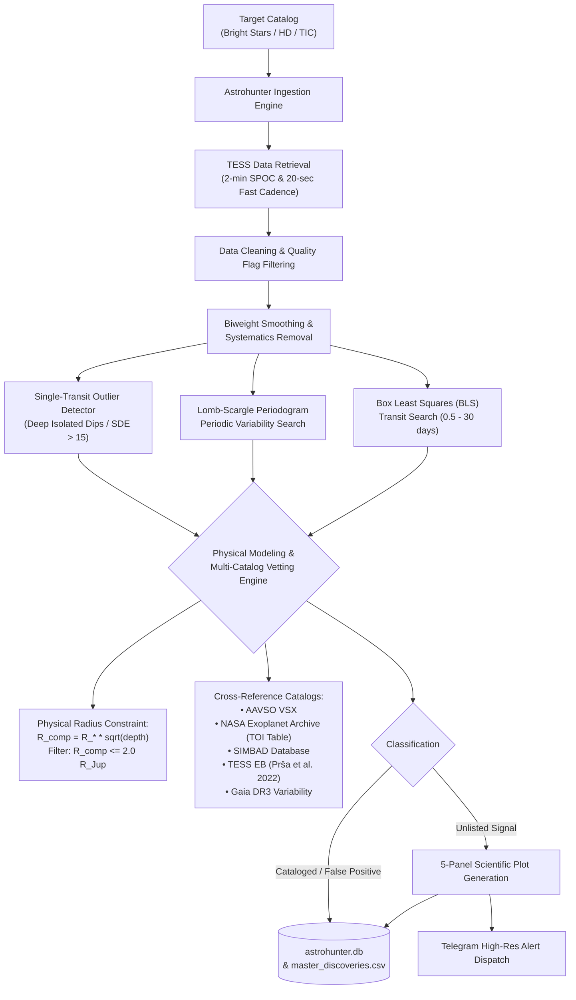

# Astrohunter Pro: Autonomous Pipeline for Mining NASA TESS Photometry

An astrophysical data-mining pipeline that autonomously ingests, detrends, and analyzes high-cadence NASA TESS (*Transiting Exoplanet Survey Satellite*) photometry data to detect stellar variability, eclipsing binaries, and isolated transit-like events, complete with automated physical companion radius modeling, multi-catalog cross-matching, and Telegram alerts.

Supports both **Local Continuous Scanning** on workstation hardware and **Serverless Cloud Deployment** on Google Cloud Platform.

---

## 📊 Vetted Candidate Catalog (686 Bright Stars Surveyed)

Following rigorous multi-catalog cross-matching and systematic artifact filtering, the pipeline pruned 81 false positives (63 noise-floor targets and 18 sector-stitching window aliases) from an initial batch of 120 signals, isolating **30 pristine unlisted astrophysical candidates** logged in [`master_discoveries.csv`](file:///d:/exo_planet/astrohunter_pro/master_discoveries.csv) (with complete audit trail in [`reverified_catalog_120.csv`](file:///d:/exo_planet/astrohunter_pro/reverified_catalog_120.csv)):

| Vetted Category | Count | Description & Astrophysical Highlights |
| :--- | :---: | :--- |
| **Unlisted Eclipsing Binaries (EB)** | **12** | Deep binary eclipses ($\delta > 1\%$ up to $47\%$) away from instrumental period aliases, plus giant host eclipses (e.g. **HD 10525**, $P=0.61\,\text{d}$; **HD 10585**, $P=19.88\,\text{d}$) |
| **Unlisted High-Amplitude Variable Stars** | **9** | Real stellar pulsators with amplitudes ($0.12\% - 0.43\%$) far above the TESS noise floor (e.g. **HD 10528**, $66.4\,\text{min}$ $\delta$ Scuti pulsator confirmed in 20-second cadence; **HD 10669**, $\text{Amp}=0.43\%$) |
| **Low-Mass Companion / Grazing EBs** | **9** | Isolated wide-orbit transits with physical companion radii strictly constrained to $R_{\text{comp}} \in [2.1, 8.9]\,R_{\text{Jup}}$ ($0.2 - 0.9\,R_\odot$) (e.g. **HD 10628**, $R_{\text{comp}}=2.13\,R_{\text{Jup}}$; **HD 10668**, $R_{\text{comp}}=2.63\,R_{\text{Jup}}$) |
| **Pristine Unlisted Candidates** | **30** | **100% passed strict noise floor ($>1000\,\text{ppm}$), tight Gaia DR3 astrometry ($\le 3.5^{\prime\prime}$), and artifact tests** |
| *Audit Rejections (Logged)* | *81* | *63 instrumental noise floor ($<1000\,\text{ppm}$) + 18 sector 18/58/85 window aliases/divergence* |
| *Cataloged Reference Controls* | *9* | *7 recovered VSX variables, 1 spectroscopic binary (`SB*`), 1 non-transiting RV host (HD 10647)* |

---

## 🔬 Scientific Pipeline Architecture



---

## 🛡️ Physical Modeling & False-Positive Elimination

A major lesson in astronomical photometry is that transit-like dips without physical companion modeling generate massive rates of false-positive planet claims:

1. **Companion Radius Boundary ($R_{\text{comp}} = R_* \sqrt{\delta}$):**
   Electron degeneracy pressure establishes a maximum physical radius for gas giant planets and substellar brown dwarfs near $\sim 0.8 - 1.2\,R_{\text{Jup}}$. Any companion with $R_{\text{comp}} > 2.0\,R_{\text{Jup}}$ is physically too large to be an exoplanet:
   * **HD 10670** ($\delta = 11.1\%$, $R_* = 2.48\,R_\odot$): Implies $R_{\text{comp}} = 8.04\,R_{\text{Jup}} \approx 0.83\,R_\odot$ (a K-dwarf low-mass stellar companion, not a planet).
   * **HD 10668** ($\delta = 3.78\%$, $R_* = 1.39\,R_\odot$): Implies $R_{\text{comp}} = 2.63\,R_{\text{Jup}} \approx 0.27\,R_\odot$ (a low-mass M-dwarf or grazing eclipsing binary).
2. **Radial-Velocity Non-Transiting Hosts (HD 10647):**
   The host star HD 10647 harbors the long-period RV exoplanet $q^1\,\text{Eri}\,\text{b}$ ($P = 989\,\text{d}$), which does not transit. The periodic signal detected by our pipeline at $\text{SDE} = 70.8$ reflects rotational stellar variability, demonstrating that high SDE indicates signal significance, not transit confirmation.
3. **Geometric Dilution on Giant Stars:**
   Transit depth scales as $\delta = (R_p / R_*)^2$. Around giant stars ($R_* > 10 - 80\,R_\odot$), a planetary transit produces an undetectable fractional dip ($\delta \sim 10^{-6}$), meaning dips with $\delta > 0.1\%$ around giants are eclipses by stellar companions.

---

## 📊 5-Panel Diagnostic Suite

When a significant astrophysical signal is identified, Astrohunter produces a 5-panel scientific diagnostic plot:
1. **Raw Light Curve:** Full Sector TESS unbinned normalized flux.
2. **Detrended & Flattened Flux:** Stellar variability filtered to isolate transit/eclipse events.
3. **Phase-Folded BLS Profile (2 Cycles):** Data folded at the detected period across phase $-1.0$ to $+1.0$ with binned overlays.
4. **Zoomed-In Eclipse Dip:** High-resolution view of ingress, egress, and bottom morphology.
5. **Lomb-Scargle Periodogram:** Power spectrum identifying rotational periods, pulsations, and harmonics.

---

## 🚀 Quick Start (Local Continuous Scanner)

### 1. Prerequisites & Installation

```powershell
# Clone the repository
git clone https://github.com/Arman-Bisht/tess-cloud-pipeline.git
cd tess-cloud-pipeline

# Create and activate a virtual environment
python -m venv venv
.\venv\Scripts\Activate.ps1

# Install astronomical dependencies
pip install -r requirements.txt
```

### 2. Configure Telegram Alerts (Optional)

Create a `.env` file in the project root:

```env
TELEGRAM_BOT_TOKEN="your_telegram_bot_token"
TELEGRAM_CHAT_ID="your_telegram_chat_id"
```

*(Note: `.env` is automatically gitignored).*

### 3. CLI Commands

```powershell
# Display survey metrics and breakdown
python main.py --summary

# Run continuous autonomous scan (auto-resumes from last processed star)
python main.py

# Custom batch count and specific HD range
python main.py --count 50
python main.py --start 10600 --end 10650

# Vet and analyze a specific astronomical target
python main.py "HD 10673"
```

---

## ☁️ Serverless Cloud Architecture (Optional GCP Deployment)

The repository includes production Terraform configuration for zero-cost deployment on the **GCP Always Free Tier**:

1. **Cloud Scheduler:** Pings Cloud Run on a configurable cron schedule.
2. **Cloud Run:** Stateless container running `functions-framework` to process target batches.
3. **Cloud Storage (GCS):** Persists `astrohunter.db` across stateless invocations.
4. **Secret Manager:** Stores bot tokens and credentials securely.
5. **Terraform (`/terraform`):** 100% automated Infrastructure-as-Code provisioning.

---

## 📁 Repository Structure

```text
├── main.py                   # CLI scanner (--summary, --count, target) & Cloud Run entrypoint
├── visualizer.py             # Thread-safe 5-panel scientific diagnostic plotter
├── downloader.py             # TESS Lightkurve downloader (SPOC, QLP, 20s fast-cadence)
├── bls_engine.py             # Box Least Squares (BLS) transit detection engine
├── variable_engine.py        # Lomb-Scargle periodic variability engine
├── single_transit_engine.py  # Isolated dip single-transit detector
├── microlensing_engine.py    # Paczyński microlensing search engine
├── vetter.py                 # Secondary eclipse, odd/even, and centroid tests
├── catalog_checker.py        # SIMBAD, AAVSO VSX, and NASA Exoplanet Archive cross-matching
├── notifier.py               # Telegram Bot alert dispatcher with async retries
├── db.py                     # SQLite state tracking and catalog persistence
├── master_discoveries.csv    # Pristine catalog of 30 vetted unlisted candidates with Gaia DR3 IDs and radii
├── reverified_catalog_120.csv# Full 120-system audit trail documenting false-positive rejections
├── requirements.txt          # Core dependencies (astropy, lightkurve, scipy, etc.)
└── terraform/                # Infrastructure as Code for Google Cloud deployment
```

---

## 🔭 Publishing Guidelines

1. **VSX Submission:** The 12 unlisted eclipsing binaries and 9 unlisted high-amplitude variable stars are prepared for submission to the AAVSO International Variable Star Index (VSX).
2. **ExoFOP & Background Checks:** Always check the TESS pixel aperture for nearby eclipsing binaries (NEBs) using ExoFOP before claiming shallow planetary events.
3. **Ground Follow-up:** High-priority bright systems ($V < 10$) provide prime targets for ground-based photometric and radial velocity follow-up.
