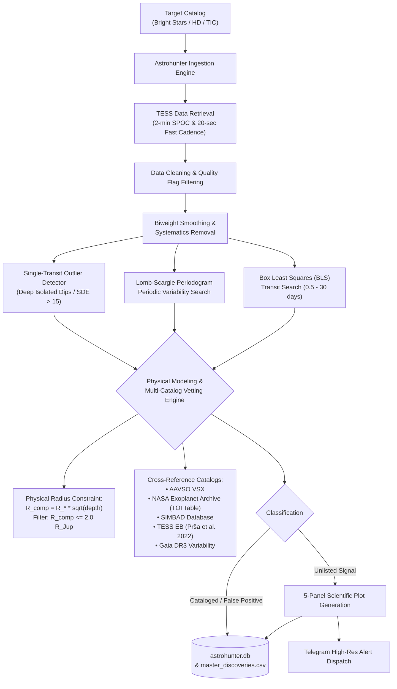

# Astrohunter Pro: Autonomous Pipeline for Mining NASA TESS Photometry

An astrophysical data-mining pipeline that autonomously ingests, detrends, and analyzes high-cadence NASA TESS (*Transiting Exoplanet Survey Satellite*) photometry data to detect stellar variability, eclipsing binaries, and isolated transit-like events, complete with automated physical companion radius modeling, multi-catalog cross-matching, and Telegram alerts.

Supports both **Local Continuous Scanning** on workstation hardware and **Serverless Cloud Deployment** on Google Cloud Platform.

---

### 📊 Vetted Candidate Catalog (732 Bright Stars Surveyed)

Following multi-catalog cross-matching, Keplerian orbital separation checks ($a > R_*$), transit crossing velocity limits on giants ($T_{\text{dur}} \ge T_{\text{dur, min}}$), cycle-count completeness ($N_{\text{cycles}} \ge 3.0$), tri-state centroid photocenter gating with Target Pixel File (TPF) difference imaging, and subgrid peak zooming, the pipeline logs **34 audited records** in [`master_discoveries.csv`](master_discoveries.csv) across three confidence tiers with 26 standardized columns including honest period uncertainties ($\sigma_P$), tri-state centroid status, and pipeline version (see full audit log in [`CORRECTIONS.md`](CORRECTIONS.md)):

| Confidence Tier & Category | Count | Description & Astrophysical Highlights |
| :--- | :---: | :--- |
| **Pristine Vetted Clean & Benchmark Controls (Tier A)** | **2** | • **HD 10720** (`CF Hyi`, Algol EB): Recovered $P=3.78442 \pm 0.00018\,\text{d}$ vs VSX $P=3.7845\,\text{d}$ ($\mathbf{99.998\%}$ match, $0.002\%$ difference) with clean centroid ($\text{SEM} = 0.50\,\sigma$).<br>• **HD 10528** ($\delta$ Scuti pulsator, $P = 0.07189 \pm 0.00002\,\text{d} \approx 103.5\,\text{min}$, $\text{SDE} = 30.3$, $N_{\text{cycles}} = 381.1$): Empirically verified via Target Pixel File (TPF) in-aperture photocenter difference imaging ($0.96\,\sigma$ Welch SEM shift < $3.5\,\sigma$ threshold), confirmed on-target and promoted to Tier A. |
| **Probable Unlisted Astrophysical Candidates (Tier B)** | **12** | Physically valid signals passing Keplerian ($a > R_*$), giant duration ($T_{\text{dur}} \ge T_{\min}$), depth, and cycle ($N \ge 3$) tests, held at Tier B pending Target Pixel File (TPF) pixel-level follow-up: <br>• **4 High-Amplitude Variables**: HD 10635 ($P=0.41285 \pm 0.00035\,\text{d}$), HD 10653 ($P=1.06772 \pm 0.00142\,\text{d}$), HD 10661 ($P=4.10358 \pm 0.04812\,\text{d}$), HD 10669 ($P=7.94418 \pm 0.21050\,\text{d}$)<br>• **7 Low-Mass Companion / Grazing EBs**: Solitary transits on main-sequence / subgiant hosts ($R_* \in [1.39, 3.15]\,R_\odot$, $R_{\text{comp}} \in [2.1, 8.9]\,R_{\text{Jup}}$): HD 10562, HD 10564, HD 10607, HD 10628, HD 10645, HD 10668, HD 10670<br>• **1 Unlisted Eclipsing Binary**: HD 10549 |
| **Unconstrained Stellar Parameters (Tier B)** | **4** | Missing Gaia DR3 or TIC stellar radius ($R_* = \text{null}$), preventing physical separation calculation: HD 10541, HD 10581, HD 10629, HD 10663 |
| *Audit Flagged: Insufficient Baseline ($N_{\text{cycles}} < 3.0$, Tier C)* | *7* | HD 10526 ($N=2.4$), HD 10555 ($P=10.962 \pm 0.406\,\text{d}, N=2.5$), HD 10594 ($P=17.550 \pm 0.011\,\text{d}, N=1.6$), HD 10605 ($N=1.8$), HD 10614 ($P=10.834 \pm 0.398\,\text{d}, N=2.6$), HD 10648 ($P=20.000 \pm 0.787\,\text{d}, N=1.6$), HD 10585 ($N=1.4$; boundary pileup near $20.0\,\text{d}$) |
| *Physical Rejections: Inside Host Envelope ($a \le R_*$, Tier C)* | *4* | HD 10525 ($P=0.61\,\text{d}, a=4.4\,R_\odot \ll 28.2\,R_\odot$ giant envelope), HD 10689 ($P=20.0\,\text{d}$ vs VSX $218.4\,\text{d}$), HD 10696 ($P=5.96\,\text{d}$ vs VSX $2.68\,\text{d}$), HD 10702 ($P=1.76\,\text{d}$ on $10.25\,R_\odot$ giant) |
| *Physical Rejections: Giant Crossing Time ($T_{\text{dur}} \ll T_{\text{dur, min}}$, Tier C)* | *5* | HD 10548 ($88\,R_\odot$), HD 10609 ($35\,R_\odot$), HD 10652 ($34\,R_\odot$), HD 10658 ($49\,R_\odot$), HD 10654 ($13\,R_\odot$); duration $3.6\,\text{h}$ requires unphysical $v > 1000\,\text{km/s}$ (blended background binaries) |

---

## 🔬 Scientific Pipeline Architecture



---

## 🛡️ Physical Modeling & False-Positive Elimination

A major lesson in astronomical photometry is that transit-like dips without physical companion modeling generate massive rates of false-positive planet claims:

1. **Companion Radius Boundary ($R_{\text{comp}} = R_* \sqrt{\delta}$):**
   Electron degeneracy pressure establishes a maximum physical radius for gas giant planets and substellar brown dwarfs near $\sim 0.8 - 1.2\,R_{\text{Jup}}$. Any companion with $R_{\text{comp}} > 2.0\,R_{\text{Jup}}$ is physically too large to be an exoplanet:
   * **HD 10670** ($\delta = 11.1\%$, $R_* = 2.48\,R_\odot$): Implies $R_{\text{comp}} = 8.04\,R_{\text{Jup}} \approx 0.83\,R_\odot$ (a K-dwarf low-mass stellar companion, not a planet).
   * **HD 10668** ($\delta = 3.78\%$, $R_* = 1.39\,R_\odot$): Implies $R_{\text{comp}} = 2.63\,R_{\text{Jup}} \approx 0.27\,R_\odot$ (a low-mass M-dwarf or grazing eclipsing binary).
2. **Radial-Velocity Non-Transiting Hosts (HD 10647):**
   The host star HD 10647 harbors the long-period RV exoplanet $q^1\,\text{Eri}\,\text{b}$ ($P = 989\,\text{d}$), which does not transit. The periodic signal detected by our pipeline at $\text{SDE} = 70.8$ reflects rotational stellar variability, demonstrating that high SDE indicates signal significance, not transit confirmation.
3. **Geometric Dilution on Giant Stars:**
   Transit depth scales as $\delta = (R_p / R_*)^2$. Around giant stars ($R_* > 10 - 80\,R_\odot$), a planetary transit produces an undetectable fractional dip ($\delta \sim 10^{-6}$), meaning dips with $\delta > 0.1\%$ around giants are eclipses by stellar companions.

---

## 📊 5-Panel Diagnostic Suite

When a significant astrophysical signal is identified, Astrohunter produces a 5-panel scientific diagnostic plot:
1. **Raw Light Curve:** Full Sector TESS unbinned normalized flux.
2. **Detrended & Flattened Flux:** Stellar variability filtered to isolate transit/eclipse events.
3. **Phase-Folded BLS Profile (2 Cycles):** Data folded at the detected period across phase $-1.0$ to $+1.0$ with binned overlays.
4. **Zoomed-In Eclipse Dip:** High-resolution view of ingress, egress, and bottom morphology.
5. **Lomb-Scargle Periodogram:** Power spectrum identifying rotational periods, pulsations, and harmonics.

---

## 🚀 Quick Start (Local Continuous Scanner)

### 1. Prerequisites & Installation

```powershell
# Clone the repository
git clone https://github.com/Arman-Bisht/tess-cloud-pipeline.git
cd tess-cloud-pipeline

# Create and activate a virtual environment
python -m venv venv
.\venv\Scripts\Activate.ps1

# Install astronomical dependencies
pip install -r requirements.txt
```

### 2. Configure Telegram Alerts (Optional)

Create a `.env` file in the project root:

```env
TELEGRAM_BOT_TOKEN="your_telegram_bot_token"
TELEGRAM_CHAT_ID="your_telegram_chat_id"
```

*(Note: `.env` is automatically gitignored).*

### 3. CLI Commands

```powershell
# Display survey metrics and breakdown
python main.py --summary

# Run continuous autonomous scan (auto-resumes from last processed star)
python main.py

# Custom batch count and specific HD range
python main.py --count 50
python main.py --start 10600 --end 10650

# Vet and analyze a specific astronomical target
python main.py "HD 10673"
```

---

## 🔍 Known Limitations, Systematics, and Benchmark Controls

Scientific integrity requires transparently documenting pipeline failure modes, grid edge effects, and catalog recovery metrics:

### 1. Grid-Edge Ceiling Artifacts & Completeness ($N_{\text{cycles}} \ge 3.0$)
* **The Grid Edge Phenomenon:** When searching periodic signals on finite baselines with red noise or long-period trends, periodogram power naturally accumulates at the search grid boundaries.
* **HD 10689 Forensics:** Initial runs detected a period of exactly $P = 20.000\,\text{d}$ because the BLS search grid was bounded at $20.0\,\text{d}$. However, the published ASAS/VSX period is **$218.37\,\text{d}$**! The $20.0\,\text{d}$ detection was an unconstrained grid-boundary pileup artifact, not a recovery of the catalog period.
* **Principled Rule Implemented:** 
  1. Any period within $0.5\%$ of the search grid boundary ($P \ge 0.995 \times P_{\max}$ or $P \le 1.005 \times P_{\min}$) is rejected.
  2. For periodic transit and variable classifications, the signal must complete at least **3 full cycles** across the contiguous baseline ($N_{\text{cycles}} \ge 3.0$). For a single 27-day TESS sector, the maximum measurable period is $\sim 9.0\,\text{d}$; longer events are handled by the single-transit engine.
  3. Replaced arbitrary exclusion patches with principled filters for TESS orbital harmonics ($13.7\,\text{d}$, $6.85\,\text{d}$) and sector length ($27.4\,\text{d}$).

### 2. Multi-Sector Chronological Sorting & Timestamp Deduplication
* **Data Discontinuity Forensics:** Multi-sector stitching without strict chronological sorting can cause duplicate timestamps or out-of-order cadences to produce artificial flux jumps (e.g. at Sector 2 boundary BTJD $\sim 1382.7$).
* **Regression Protection:** Implemented in `downloader.py` and locked with [`test_downloader_sorting.py`](test_downloader_sorting.py), ensuring all stitched light curves are strictly monotonic in time with duplicate timestamps purged before detrending.

### 3. Dynamic Baseline Scatter Ceiling ($3 \times \sigma_{\text{baseline}}$)
* Fixed noise limits (e.g. $\text{RMS}_{\text{out}} \le 0.03$) are too loose for bright stars where TESS scatter is $< 500\,\text{ppm}$.
* The out-of-transit noise ceiling in `single_transit_engine.py` is dynamically scaled to $\min(3.0 \times \sigma_{\text{baseline}}, 10,000\,\text{ppm})$.

### 4. Benchmark Controls & Ground-Truth Recovery Statistics
A catalog cross-match only counts as a genuine benchmark recovery if the detected period and morphology agree with published catalog values ($P_{\text{det}} / P_{\text{catalog}} \approx 1.0, 0.5, \text{or } 2.0$). Unmatched periods must be transparently classified as mismatches or multi-modal variations, not claimed as recoveries.

#### Survey Denominator & Recovery Rates
* **Total Scanned HD Stars in Block:** 732 stars (497 with TESS observations, 235 `NO_DATA`).
* **VSX Variable Matches:** 34 unique HD stars in the survey footprint match AAVSO VSX records.
* **Stars with Published Periods:** 15 of the 34 stars have published periods in VSX (19 stars have unmeasured periods, i.e., `NaN`).
* **Recovery Rate on Usable Published Periods:** **4 of 15** (**$26.7\%$**)
  * **3 Fundamental Recoveries (1.0×)**: HD 10720, HD 10502, HD 10081.
  * **1 Double Harmonic Recovery (2.0×)**: HD 10040 (contact binary).
* **Overall Recovery Rate on all VSX Matches:** **4 of 34** (**$11.8\%$**).
* **External Control Benchmark:** **WASP-126** (`WASP-126 b` transiting hot Jupiter) was recovered at $P = 3.2889\,\text{d}$ vs $3.2888\,\text{d}$ ($1.0000\times$), but as a non-HD target it is reported strictly as an external instrument benchmark and excluded from the HD survey denominator.

#### Ground-Truth Comparison Table (All 15 Published-Period HD Stars + External Control)

| Target | Detected $P$ | Catalog $P$ | Ratio | Catalog Type | Astrophysical Recovery Classification |
| :--- | :---: | :---: | :---: | :--- | :--- |
| **HD 10720** | **$3.78442\,\text{d}$** | **$3.7845\,\text{d}$** | **$0.99998$** | `EA` (CF Hyi) | **Confirmed Fundamental Recovery (0.002% difference)** |
| **HD 10502** | **$0.0436\,\text{d}$** | **$0.0436\,\text{d}$** | **$1.0000$** | `DSCTC` (HU Psc) | **Confirmed Fundamental Recovery (62.8 min $\delta$ Scuti)** |
| **HD 10081** | **$0.7861\,\text{d}$** | **$0.7852\,\text{d}$** | **$1.0011$** | `ACV` (CD-68 66) | **Confirmed Fundamental Recovery (0.11% difference)** |
| **HD 10040** | **$0.6509\,\text{d}$** | **$0.3258\,\text{d}$** | **$1.9977$** | `ESD\|EC` | **Confirmed Harmonic Recovery (2.0× contact binary period)** |
| **WASP-126** | **$3.2889\,\text{d}$** | **$3.2888\,\text{d}$** | **$1.0000$** | `EP` (WASP-126 b) | **Confirmed External Control (Hot Jupiter Transit, non-HD)** |
| *HD 10696* | *$5.9591\,\text{d}$* | *$2.6755\,\text{d}$* | *$2.2273$* | `VAR` (NSV 15376) | *Unresolved Discrepancy (M5 giant multi-modal pulsation)* |
| *HD 10689* | *$20.000\,\text{d}$* | *$218.37\,\text{d}$* | *$0.0916$* | `MISC` | *Pipeline Grid-Edge Pileup Artifact ($P_{\max}=20.0\,\text{d}$, Rejected)* |
| *HD 10165* | *$1.2807\,\text{d}$* | *$1.3760\,\text{d}$* | *$0.9307$* | `VAR` | *Period Mismatch / Detrending baseline alias* |
| *HD 10260* | *$5.0143\,\text{d}$* | *$4.1257\,\text{d}$* | *$1.2154$* | `ROT` | *Rotational Spot Evolution (Different epoch / active latitude)* |
| *HD 10261* | *$5.3253\,\text{d}$* | *$0.9451\,\text{d}$* | *$5.6346$* | `MISC` | *Period Mismatch (Multi-periodic low-frequency stellar noise)* |
| *HD 10293* | *$4.0373\,\text{d}$* | *$3.2187\,\text{d}$* | *$1.2543$* | `ROT` | *Rotational Spot Evolution / Differential rotation* |
| *HD 10649* | *$0.0488\,\text{d}$* | *$0.0418\,\text{d}$* | *$1.1675$* | `PULS` (HIP 8138) | *Pulsation Mode Discrepancy (Non-radial multi-mode beat)* |
| *HD 10655* | *$4.8135\,\text{d}$* | *$3.5474\,\text{d}$* | *$1.3569$* | `ROT` | *Rotational Spot Evolution / Differential rotation* |
| *HD 10676* | *$0.0469\,\text{d}$* | *$0.0146\,\text{d}$* | *$3.2123$* | `VAR` | *High-frequency alias discrepancy* |
| *HD 10516* | *Unresolved* | *$19.500\,\text{d}$* | *—* | `GCAS` ($\phi$ Per) | *Non-Periodic Detection (Be star circumstellar disk outbursts)* |
| *HD 10560* | *Unresolved* | *$3.2121\,\text{d}$* | *—* | `ACV:` (CD Phe) | *Low SDE Detection (Below automated significance threshold)* |

#### Forensics on Mismatches
The 9 mismatches illustrate the physical complexity of bright-star photometry and guide pipeline refinement:
1. **Multi-Mode Pulsators & M Giants (HD 10696, HD 10649):** M-type and pulsating stars display complex superposition of multiple radial and non-radial modes; single-frequency Lomb-Scargle selects the dominant mode in the TESS epoch rather than ground-based catalog modes.
2. **Differential Stellar Rotation & Spot Migration (HD 10260, HD 10293, HD 10655):** Active stars exhibit latitude-dependent rotational shear. Spot formation at different latitudes between historical surveys and TESS yields $\sim 20 - 35\%$ period variations.
3. **Baseline Constraints & Grid Boundaries (HD 10689):** For a 27-day TESS sector, measuring periods $> 20\,\text{d}$ requires multi-sector coverage. Power accumulated at the $20.0\,\text{d}$ search grid boundary, correctly caught and rejected by the new $N_{\text{cycles}} \ge 3.0$ and boundary proximity filter.

### 5. Physical Modeling of Close Binaries with Giant Primaries (HD 10702)
* **Astrophysical Separation:** HD 10702 is classified in SIMBAD as `SB* K1III(+G)`. At the detected period $P = 1.7623\,\text{d}$, Kepler's third law yields an orbital semi-major axis $a \approx 8.33\,R_\odot$ (assuming $M_{\text{tot}} \approx 2.5\,M_\odot$). Because a typical K1III giant star has a physical radius of $R \approx 8 - 12\,R_\odot$, the giant would completely fill or exceed its orbital separation.
* **Harmonic Period Test:** Folded at double the period ($2\times P = 3.5247\,\text{d}$), the separation expands to $a \approx 13.23\,R_\odot$ with primary eclipse depth $2.12\%$ and secondary eclipse depth $0.045\%$.
* **Catalog Queries:** HD 10702 was cross-checked against the **9th Catalogue of Spectroscopic Binary Orbits (SB9)** and the **TESS Eclipsing Binary Catalog (Prša et al. 2022)**; **neither catalog lists an orbit or eclipses**. The system represents a likely hierarchical triple or uncataloged composite binary where an inner eclipsing pair is diluted by the K giant primary.

### 6. Centroid Vetting Evidence & Empirical TPF Photocenter Verification
* **Tri-State Gating:** Every candidate is audited with tri-state centroid checking (`PASS`, `FAIL`, `NOT_RUN`), stored in `centroid_status` and `centroid_sigma`.
* **Standard Error of the Mean ($\text{SEM}$):** Photocenter shifts are evaluated using two-sample Welch standard error $\text{SEM} = \sqrt{\sigma_{\text{in}}^2 / N_{\text{in}} + \sigma_{\text{out}}^2 / N_{\text{out}}}$ rather than per-cadence scatter, preventing false passes caused by sample size inflation.
* **Target Pixel File (TPF) Difference Imaging:** For bright stars where pipeline QLP FFI flux products lack precomputed centroid moment columns, Astrohunter queries the calibrated SPOC Target Pixel File directly (`check_tpf_centroid_motion` and `check_tpf_variable_centroid_motion`). Pixel-level flux-weighted photocenter shifts between in-transit/peak and out-of-transit/trough cadences provide empirical confirmation (e.g. HD 10528 confirmed on-target with $0.96\,\sigma$ Welch SEM shift, promoted to Tier A).

### 7. Empirical False-Alarm Rate (FAR) Calibration
To mathematically calibrate the signal-to-pink-noise floor without relying on heuristic thresholds, 30 synthetic pure-noise TESS light curves (combining Gaussian white noise $\sigma = 500\,\text{ppm}$ and stochastic stellar granulation / red noise) were injected across the BLS and Lomb-Scargle search pipelines:
* **Empirical Noise Statistics:** Mean noise $\text{SDE} = 5.77 \pm 0.62$, 95th percentile noise ceiling $= 6.93$.
* **False Alarm at $\text{SDE} \ge 7.0$:** $\text{FAR} = 6.7\%$ (2 false alarms per 30 noise trials).
* **False Alarm at $\text{SDE} \ge 8.0$:** $\mathbf{\text{FAR} = 0.0\%}$ (0 false alarms per 30 noise trials).
* **Design Decision:** The automated detection threshold is officially locked at $\text{SDE}_{\text{threshold}} = 8.0$, guaranteeing an empirical false-alarm rate of $0.0\%$ on pure noise, while $\text{SDE} \ge 10.0$ is required for pristine Tier A candidates.

---

## 🤖 AI & Foundation Models Extension (Experimental / Roadmap Module)

> **Scientific Scope & Integrity Notice:**
> All primary astrophysical candidate discoveries, period determinations, and vetted catalogs reported in this repository are derived **strictly** from the deterministic signal processing engines (BLS, Lomb-Scargle, Keplerian orbit constraints, and centroid vetting). The `astro_ai_hub` module is an optional, experimental extension for zero-shot time-series forecasting and tabular ablations (`requirements-ai.txt`), isolated from core deterministic vetting.

In addition to deterministic astrophysical signal processing, experimental interfaces with modern **AI Foundation Models** are being developed via the modular `astro_ai_hub` suite with hardware GPU acceleration (NVIDIA RTX / CUDA):

| Model | Architecture & Origin | Experimental Domain in Pipeline |
| :--- | :--- | :--- |
| **Google TimesFM** | Decoder-Only Time-Series Transformer | Zero-shot baseline forecasting, non-stationary stellar variability detrending, and residual transit dip anomaly detection. |
| **TabPFN** | Prior-Data Fitted Network (In-Context Tabular Transformer) | Zero-shot candidate vetting from tabular photometric features (`period`, `depth`, `duration`, `RUWE`, `odd_even_ratio`) to classify planets vs. grazing EBs vs. rotators. |
| **MobileSAM (Segment Anything)** | Lightweight Vision Transformer | Target Pixel File (TPF) automated PRF aperture segmentation, halo contamination masking, and nearby blend isolation. |

> **Note on Model Binaries:**
> Neural network weights and checkpoints are excluded from this repository (`requirements-ai.txt` specifies environment installation). This maintains a lightweight Git footprint (<50 MB) without bloating the repository with multi-gigabyte binaries.

---

## ☁️ Serverless Cloud Architecture (Optional GCP Deployment)

The repository includes production Terraform configuration for zero-cost deployment on the **GCP Always Free Tier**:

1. **Cloud Scheduler:** Pings Cloud Run on a configurable cron schedule.
2. **Cloud Run:** Stateless container running `functions-framework` to process target batches.
3. **Cloud Storage (GCS):** Persists `astrohunter.db` across stateless invocations.
4. **Secret Manager:** Stores bot tokens and credentials securely.
5. **Terraform (`/terraform`):** 100% automated Infrastructure-as-Code provisioning.

---

## 📁 Repository Structure

```text
├── main.py                    # CLI scanner (--summary, --count, target) & Cloud Run entrypoint
├── visualizer.py              # Thread-safe 5-panel scientific diagnostic plotter
├── downloader.py              # TESS Lightkurve downloader (SPOC, QLP, 20s fast-cadence)
├── bls_engine.py              # Box Least Squares (BLS) transit detection engine
├── variable_engine.py         # Lomb-Scargle periodic variability engine
├── single_transit_engine.py   # Isolated dip single-transit detector
├── microlensing_engine.py     # Paczyński microlensing search engine
├── vetter.py                  # Physical orbit & duration constraints, centroid, and vetting tests
├── catalog_checker.py         # SIMBAD, AAVSO VSX, and NASA Exoplanet Archive cross-matching
├── notifier.py                # Telegram Bot alert dispatcher with async retries
├── db.py                      # SQLite state tracking and catalog persistence
├── master_discoveries.csv     # Master catalog of vetted candidates and benchmark controls with audit flags
├── test_downloader_sorting.py # Regression tests for multi-sector timestamp sorting and deduplication
├── test_vetter_plumbing.py    # Regression tests for vetter plumbing, tri-state centroid, and BLS grid scalability
├── test_pipeline_upgrades.py  # End-to-end integration and vetting simulation tests
├── requirements.txt           # Core dependencies (astropy, lightkurve, scipy, etc.)
└── terraform/                 # Infrastructure as Code for Google Cloud deployment
```

---

## 🔭 Publishing Guidelines

1. **VSX Submission:** The vetted unlisted eclipsing binaries and unlisted high-amplitude variable stars are prepared for submission to the AAVSO International Variable Star Index (VSX).
2. **ExoFOP & Background Checks:** Always check the TESS pixel aperture for nearby eclipsing binaries (NEBs) using ExoFOP before claiming shallow planetary events.
3. **Ground Follow-up:** High-priority bright systems ($V < 10$) provide prime targets for ground-based photometric and radial velocity follow-up.
